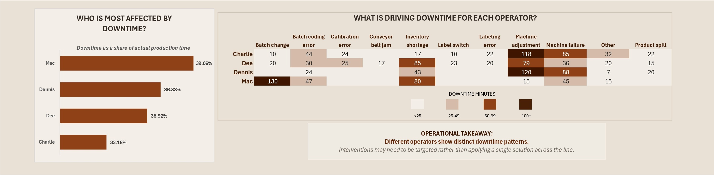

# Wolf Cola — Manufacturing Downtime Analysis

> An Excel-based analysis of production efficiency and manufacturing downtime.

## Overview

This project investigates where production time was being lost across the Wolf Cola manufacturing line and what factors were driving recorded downtime.

The analysis covers **38 production batches recorded from 29 August to 3 September 2024**.

### Key Results

| Metric | Result |
|---|---:|
| Line Efficiency | **64.02%** |
| Downtime Rate | **35.98%** |
| Total Downtime | **23h 8m** |
| Downtime Events | **61** |

**Key finding:** Five of the 12 defined downtime factors accounted for **80.4% of recorded downtime**, with machine adjustment being the largest contributor at **332 minutes**.

## Business Questions

- Where is production time being lost?
- What are the main drivers of downtime?
- Do downtime patterns differ across operators?
- Which products recorded higher downtime rates?
- Where should management focus further investigation?

## Dashboard

## Dashboard

## Tools

**Microsoft Excel**  
PivotTables • Data Transformation • Data Validation • Calculations • Dashboard Design

## Documentation

The full project documentation covers the complete analytical process, including:

- Business context and problem
- Dataset understanding
- Data cleaning and preparation
- Data modelling
- Exploratory analysis
- Key findings
- Business recommendations
- Limitations
- Future improvements

📄 **[View the Full Case Study](case-study/Wolf_Cola_Manufacturing_Downtime_Case_Study.pdf)**

## Dataset

The Manufacturing Downtime dataset was provided by **Maven Analytics** through its Data Playground and is used for educational and portfolio purposes.

